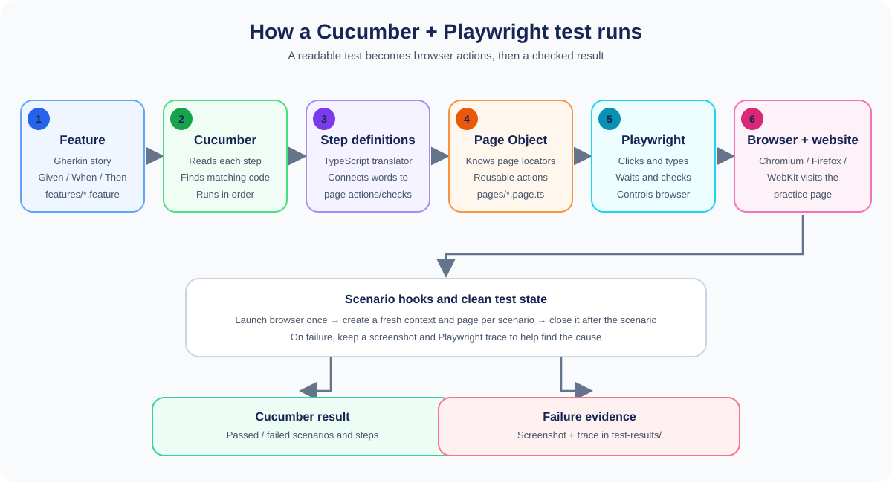

# Playwright + Cucumber + TypeScript

This project tests the [SQA Tools Automation Practice Page](https://sqatools.in/automation-practice-page/) using **Cucumber**, **Playwright**, **TypeScript**, and the **Page Object Model (POM)**.

It is written so a new learner can follow it. Imagine that a person writes a short instruction, a translator turns that instruction into computer commands, and a browser robot carries them out.

## The framework flow



### The flow in simple words

1. **Feature file — the story:** `features/*.feature` describes a test in readable Given/When/Then language.
2. **Cucumber — the reader:** Cucumber reads each story and looks for a matching TypeScript step.
3. **Step definition — the translator:** `features/step-definitions/` turns each sentence into a call to a page action or a check.
4. **Page Object — the helper:** `pages/automation-practice.page.ts` knows how to find page controls and perform reusable actions.
5. **Playwright — the browser robot:** Playwright clicks, types, selects, scrolls, uploads files, handles dialogs, and reads browser state.
6. **The website — the practice ground:** the browser interacts with the live practice page.
7. **The result — the scorecard:** Cucumber reports passed and failed steps. For a failed scenario, the framework saves a screenshot and Playwright trace in `test-results/`.

### A 5-year-old's version

Think of a toy kitchen:

- The **feature** is the recipe: “When I choose Python, then Python should be checked.”
- **Cucumber** reads the recipe out loud.
- A **step definition** understands what that sentence means.
- The **Page Object** knows where the checkbox lives.
- **Playwright** is the little robot hand that clicks it.
- The **browser** is the toy kitchen where we see whether it worked.

The robot starts with a clean play area for every test, so one test's toys do not get mixed up with another test's toys.

## What is installed here?

- **Node.js and npm** run the TypeScript tools and install dependencies.
- **Cucumber** reads `.feature` files and runs their steps in order.
- **Playwright** controls Chromium, Firefox, and WebKit.
- **TypeScript** adds type checking to step definitions and page objects.
- **ts-node** lets Cucumber load the TypeScript support and step files.

The required packages and scripts are recorded in `package.json`; exact resolved package versions are recorded in `package-lock.json`.

## Use this project

### 1. Prerequisites

- Node.js 20 or newer
- npm
- Internet access to the public practice page

Check that Node.js and npm are available:

```powershell
node --version
npm --version
```

### 2. Install project packages and browsers

Open PowerShell in this folder and run:

```powershell
npm install
npm run install:browsers
```

The second command downloads Chromium, Firefox, and WebKit. To install only Chromium:

```powershell
npx playwright install chromium
```

### 3. Run the tests

```powershell
npm test
```

Run a smaller group or check the TypeScript types:

```powershell
npm run test:smoke
npm run test:forms
npm run test:widgets
npm run typecheck
```

Run one case by its ID:

```powershell
npm test -- --tags "@AP-013"
```

Run all scenarios in Chromium, Firefox, and WebKit:

```powershell
npm run test:matrix
```

The matrix command runs each browser sequentially and returns a failure exit code if any browser run contains a failing scenario.

### 4. Choose a browser or target URL

The default browser is Chromium and the default URL is the practice page. In PowerShell, set an environment variable before running Cucumber to override either:

```powershell
$env:BROWSER = "firefox"
$env:BASE_URL = "https://sqatools.in/automation-practice-page/"
npm test
```

Supported `BROWSER` values are `chromium`, `firefox`, and `webkit`.

### 5. Read the results

- The terminal lists scenario and step results.
- Every scenario starts in a new browser context and page.
- If a scenario fails, its screenshot and Playwright trace are saved in `test-results/`.
- Open a trace with Playwright's trace viewer:

```powershell
npx playwright show-trace "test-results/chromium-Reset-button-restores-the-username-to-its-initial-value.zip"
```

`test-results/` is generated output and is ignored by Git.

## How one test works, step by step

For example, run the radio-button scenario:

1. Cucumber reads the scenario in `features/page-and-form.feature`.
2. The `Given` step opens the practice page.
3. The `When` step calls the radio-button operation in the step definitions.
4. The step definition asks `AutomationPracticePage` for the correct radio locator.
5. Playwright checks the radio option in the browser.
6. The `Then` step reads the checked state and compares it with the expected state.
7. Cucumber reports the result. If a step fails, the `After` hook attaches a screenshot and saves a trace.

The exact test is:

```gherkin
Scenario Outline: Selecting a gender radio option deselects the other options
  When I select the "<gender>" gender option
  Then the "<gender>" gender option should be selected
  And exactly one gender option should be selected

  Examples:
    | gender |
    | Male   |
    | Female |
    | Other  |
```

The same steps run once for each row in `Examples`.

## Create this kind of framework from scratch

These are the build steps used for a new project. You do not need to repeat them to run this already-configured project.

### Step 1: Create a folder and initialize Node.js

```powershell
mkdir my-playwright-cucumber
cd my-playwright-cucumber
npm init -y
```

Set the package type to CommonJS (or create a `package.json` that includes `"type": "commonjs"`), as this project's Cucumber setup uses `ts-node/register`.

### Step 2: Install Cucumber, Playwright, and TypeScript tools

```powershell
npm install --save-dev @cucumber/cucumber playwright typescript ts-node @types/node
npx playwright install chromium firefox webkit
```

For an existing project, use `npm install` instead; it reads the committed lockfile and installs the versions selected for that project.

### Step 3: Make the framework folders

```powershell
mkdir features
mkdir features\step-definitions
mkdir features\support
mkdir pages
mkdir test-data
```

Add a `tsconfig.json`, a `cucumber.cjs` config, and package scripts. In this project:

- `tsconfig.json` enables strict TypeScript checking.
- `cucumber.cjs` tells Cucumber where to find features, support hooks, step definitions, and the TypeScript loader.
- `package.json` provides short commands such as `npm test` and `npm run typecheck`.

For a small starter setup, `cucumber.cjs` can contain:

```javascript
module.exports = {
  default: {
    paths: ["features/**/*.feature"],
    requireModule: ["ts-node/register"],
    require: [
      "features/support/**/*.ts",
      "features/step-definitions/**/*.ts"
    ],
    format: ["progress"],
    publishQuiet: true
  }
};
```

A strict, no-output TypeScript check can start with:

```json
{
  "compilerOptions": {
    "target": "ES2022",
    "module": "CommonJS",
    "moduleResolution": "Node",
    "strict": true,
    "esModuleInterop": true,
    "skipLibCheck": true,
    "types": ["node"],
    "noEmit": true
  },
  "include": ["features/**/*.ts"]
}
```

Add scripts like these to the `package.json` created in Step 1:

```json
{
  "type": "commonjs",
  "scripts": {
    "test": "cucumber-js",
    "typecheck": "tsc --noEmit"
  }
}
```

When merging this into an existing `package.json`, add only the shown fields; do not replace the whole file.

### Step 4: Write a human-readable feature

Create a `.feature` file under `features/`. Describe behavior, not CSS selectors:

```gherkin
Feature: Country dropdown
  Scenario: Select a country
    Given I open the automation practice page
    When I select the "India" country
    Then the selected country should be "India"
```

`Given` sets up the starting situation, `When` performs an action, and `Then` checks the result.

### Step 5: Connect the words to TypeScript steps

Create or update a TypeScript file under `features/step-definitions/`. Cucumber matches the Gherkin sentences with step definitions such as:

```typescript
When(
  "I select the {string} country",
  async function (country: string) {
    await practicePage(this).field("country").selectOption({ label: country });
  }
);
```

Use clear, reusable steps. A step should call the page object for browser interactions instead of collecting selectors in the feature file.

For example, this project's country step delegates to the page object:

```typescript
When(
  "I select the {string} country",
  async function (this: PlaywrightWorld, country: string) {
    await new AutomationPracticePage(this.page)
      .field("country")
      .selectOption({ label: country });
  }
);
```

### Step 6: Put page locators and actions in a Page Object

Create a page class under `pages/`. Keep selectors and page-specific operations together:

```typescript
field(id: string): Locator {
  return this.page.locator(`#${id}`);
}
```

The steps can now ask for `field("country")` instead of repeating a selector in several files. If the page's selector changes, update the page object in one place.

The real page object also groups meaningful controls into methods such as `gender("Female")`, `skills()`, and `dropTarget()`.

### Step 7: Create the Cucumber World and hooks

The World stores the browser, context, and page for the current scenario. Hooks:

1. Launch the selected browser once before the run.
2. Create a fresh context and page for each scenario.
3. Start tracing and open the target page.
4. Save a screenshot and trace if the scenario fails.
5. Close the context and browser when finished.

This project's implementation is in `features/support/world.ts` and `features/support/hooks.ts`.

### Step 8: Add test data and safe test values

Keep small upload files under `test-data/`. Use synthetic names and addresses, never real credentials or personal information. This project deliberately does not submit the public comment form.

### Step 9: Add commands, then validate

Add scripts to `package.json`, then run:

```powershell
npm run typecheck
npm test
npm run test:matrix
```

Start with one tagged scenario (for example, `npm test -- --tags "@AP-006"`), fix the feature/step/page-object wiring, and then run larger groups.

## How to add another test here

1. Add a scenario to the feature file that best matches its behavior.
2. Give it a unique `@AP-###` tag and a useful group tag such as `@forms`, `@dialogs`, or `@widgets`.
3. Reuse an existing step definition if the action or check already exists.
4. If a new interaction is needed, add the locator/action to `pages/automation-practice.page.ts`.
5. Add a step definition that calls that page-object method and asserts a result.
6. Run the case by tag, then run `npm run typecheck`.
7. Run the relevant feature group or full suite; inspect any screenshot/trace for failures.

Avoid fixed sleeps, guessed page messages, and tests that depend on another scenario having run first.

## Project map

```text
features/
  page-and-form.feature           Basic page, form controls, table, image
  dialogs.feature                 Alert, confirm, and prompt
  inputs-and-navigation.feature   Upload, dates/times, and links
  page-widgets.feature            Iframe, suggestions, AJAX, drag, shadow DOM
  comment-form.feature            Safe comment-field validation only
  step-definitions/               Gherkin sentence implementations
  support/                        Scenario state and browser lifecycle
pages/
  automation-practice.page.ts     Page Object Model
test-data/                        Synthetic upload fixtures
scripts/
  test-matrix.cjs                 Sequential cross-browser test runner
docs/
  framework-flow.svg              Framework flow diagram
```

## Notes about the live practice page

- The Reset scenario expects the username to return to its initial value. The live page currently has the Reset button outside a form, so it does not clear that field. The automated scenario intentionally reports this as a failure instead of hiding the behavior.
- AJAX result scenarios wait for the page's approximately three-second response.
- The hidden field check confirms that the field is hidden; the current page does not expose a reveal control.
- The comment form is checked for input and browser validation only. Tests do not post comments to the public website.
- External advertising and analytics requests are not part of the first-party test expectations.
